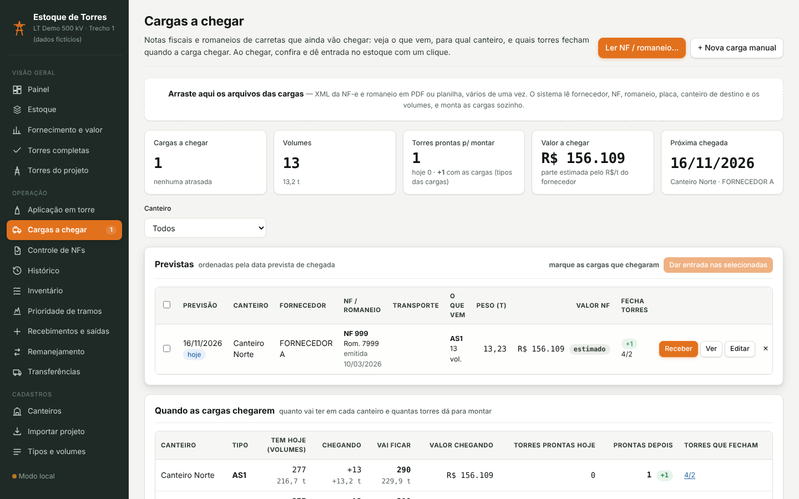
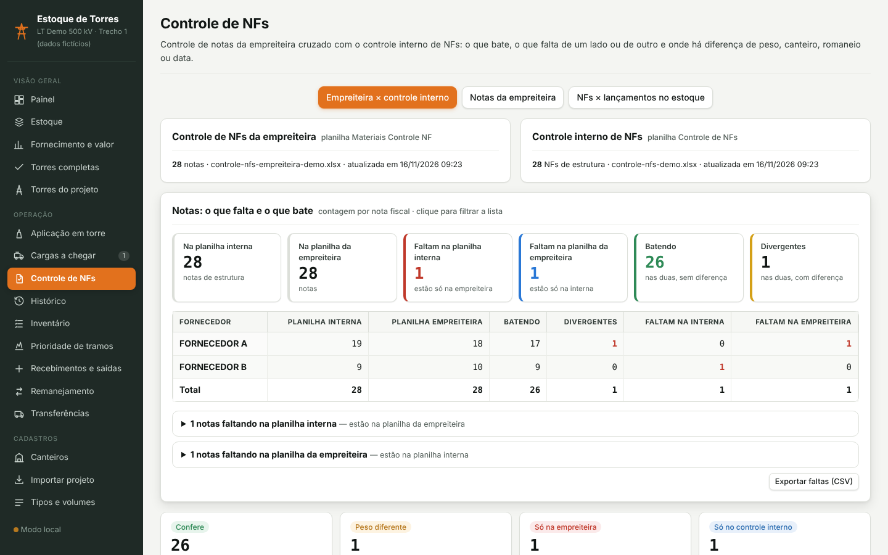
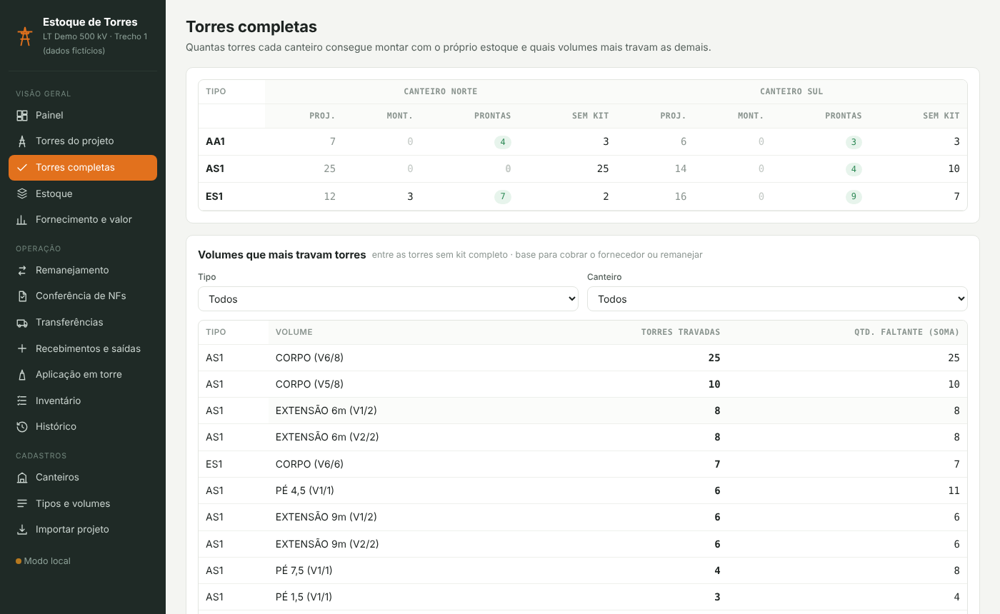

# Estoque de Torres — controle de estruturas de linhas de transmissão

Sistema para controlar o estoque de **estruturas metálicas de torres de linha de transmissão (LT)** espalhadas
em vários canteiros de obra. Ele responde às perguntas do dia a dia do planejamento:

- **O que eu tenho de verdade em cada canteiro?** (físico, reservado, disponível, a caminho, em R$)
- **Quais torres já posso montar?** O kit de cada torre é calculado individualmente a partir da lista de construção.
- **Que peças devo mover entre canteiros para completar mais torres?** Exemplo: o pé parado no canteiro X completa a torre do canteiro Y.
- **O que está chegando e quantas torres fecham quando a carga chegar?** Lendo a NF e o romaneio, antes de a carreta chegar.
- **As notas fiscais batem?** Controle de notas da empreiteira × controle interno × lançamentos de estoque.
- **Em que ritmo os fornecedores estão entregando e quando terminam?**


> [!IMPORTANT]
> **Este repositório só contém dados fictícios.** Obra, canteiros, fornecedores, volumes, pesos, valores, notas e
> romaneios de exemplo foram gerados pelos scripts em `ferramentas/demo/`. **Nenhuma planilha, nota fiscal,
> romaneio ou dado real de obra faz parte do repositório — e não deve fazer.** Leia
> [Uso correto e proteção de dados](#uso-correto-e-proteção-de-dados) antes de usar com dados de um projeto real.

---

## Sumário
- [O problema](#o-problema)
- [Funcionalidades](#funcionalidades)
- [Uso correto e proteção de dados](#uso-correto-e-proteção-de-dados)
- [Como rodar](#como-rodar)
- [Arquitetura](#arquitetura)
- [Regras de negócio](#regras-de-negócio)
- [Usar com dados de uma obra real](#usar-com-dados-de-uma-obra-real)
- [Testes](#testes)
- [Estrutura do repositório](#estrutura-do-repositório)
- [Roadmap](#roadmap)

## O problema

Uma torre não é uma peça única: ela chega do fabricante em dezenas de **volumes** (corpo, cabeça, extensões,
pernas, stubs…), muitas vezes em caminhões e canteiros diferentes. E **duas torres do mesmo tipo podem precisar
de volumes diferentes**: cada uma tem a sua extensão e cada um dos quatro pés tem a sua altura de perna, conforme a
lista de construção (LC).

No controle feito só em planilha, é difícil saber quantas torres estão realmente completas, qual peça falta em
cada uma, se alguma peça parada em outro canteiro resolveria o problema e se as notas fiscais conferem com o que
chegou.

## Funcionalidades

**Visão geral**

| Tela | O que faz |
|---|---|
| **Painel** | Torres no projeto, montadas, prontas para montar, ganho com remanejamento, peso/valor do estoque, cargas a chegar e alertas. |
| **Estoque** | Por volume: disponível em cada canteiro × necessário para as torres pendentes, com reservado e a caminho. |
| **Fornecimento e valor** | Previsto × recebido por fornecedor, gráfico semanal, ritmo, previsão de término e valor do estoque em R$. |
| **Torres completas** | Um quadro por canteiro: cada tipo com miniatura, estrutura (estaiada/autoportante) e fixação, prontas × sem kit, e os **volumes que mais travam torres**. |
| **Torres do projeto** | Mapa com miniatura de cada torre da LC (pronta, incompleta, montada), filtro por tramo e o kit detalhado de cada torre. |

**Operação**

| Tela | O que faz |
|---|---|
| **Cargas a chegar** | Registre a carga pela **NF-e (XML), DANFE (PDF) ou romaneio (PDF/planilha)**: o sistema lê fornecedor, NF, romaneio, placa, destino, valor, peso e os volumes, junta NF + romaneio da mesma carreta e mostra **quanto vai ter e quantas torres ficam prontas quando a carga chegar**. Volumes ou tipos ainda sem cadastro são cadastrados na hora. Recebimento item a item ou de várias cargas de uma vez. |
| **Controle de NFs** | Cruza o **controle de notas da empreiteira** com o **controle interno de NFs**: quantas notas faltam em cada planilha, quais batem e quais divergem (peso, valor, canteiro, romaneio, data, NF repetida), com controles sugeridos e exportação CSV. Uma terceira visão confere NFs × lançamentos de estoque. |
| **Remanejamento** | Sugere transferências entre canteiros que completam o máximo de torres, com ganho verificado por simulação. |
| **Prioridade de tramos** | Escolha o trecho (torre X a torre Y) e veja o que já dá para montar com o estoque ou remanejando. |
| **Transferências** | Fluxo `SOLICITADA → EM TRÂNSITO → RECEBIDA` (ou `CANCELADA`), com reserva na origem e conferência no recebimento. |
| **Recebimentos, aplicação, inventário, histórico** | Entradas por NF/romaneio, baixa por torre, contagem física com ajuste e razão completo com estorno (nada é apagado). |

**Cadastros e importação**

| Tela | O que faz |
|---|---|
| **Tipos e volumes** | Catálogo por tipo de torre, regra de montagem (estaiada/autoportante) e **fornecedor de cada tipo** — a leitura de notas só reconhece peças dos tipos daquele fornecedor. |
| **Importar projeto** | Atualização semanal pela **planilha de estoque da empreiteira** (mostra o que muda antes de gravar e não duplica), controle de NFs da empreiteira, controle interno de NFs, metragem de estai por torre e **zerar dados com backup**. |

| Cargas a chegar | Controle de NFs |
|---|---|
|  |  |

| Torres completas | Kit de uma torre |
|---|---|
|  |  |

## Uso correto e proteção de dados

O sistema foi feito para trabalhar com documentos de obra que **são confidenciais**: planilhas de estoque e de
controle de notas, notas fiscais (com CNPJ, chave de acesso e valores), romaneios, placas de veículos, nomes de
empresas, de canteiros e de pessoas. Regras para não expor nada disso:

1. **O código é público; os dados, nunca.** Os dados reais ficam só na instância privada do app (banco do artefato
   ou da API com acesso controlado) — nunca em commit, issue, pull request, print de README ou fork público.
2. **Não versione documentos da obra.** O `.gitignore` já bloqueia planilhas (`.xlsx/.xlsm/.xls`), `.csv`, `.pdf`,
   XMLs de NF-e, backups (`backup-estoque*.json`), o pacote `web/dados-projeto.json` e os desenhos locais
   (`web/figuras.css`, `web/img/`). Só `docs/exemplos/` aceita planilhas, e lá só entra **dado fictício**.
3. **Ative a verificação antes de cada commit:**
   ```bash
   cp .sensiveis.exemplo .sensiveis.local      # liste aqui os nomes reais: obra, empresas, canteiros, pessoas
   ln -s ../../ferramentas/seguranca/pre-commit .git/hooks/pre-commit
   python3 ferramentas/seguranca/verificar_dados_sensiveis.py   # verificação manual
   ```
   O verificador falha se encontrar documentos fiscais, chave de NF-e, CNPJ/CPF ou qualquer termo da sua lista
   privada `.sensiveis.local` (que também fica fora do git). O CI roda a mesma verificação em todo push.
4. **Nada de nomes reais no código.** Nomes de obra, contratante, fornecedores e canteiros vêm sempre dos dados
   (tela *Canteiros* → nome da obra e do contratante; cadastro de tipos → fornecedor). Exemplos e testes usam
   “Fornecedor A”, “Canteiro Norte” etc.
5. **Capturas de tela só com os dados de demonstração** (`ferramentas/demo/` + `docs/exemplos/`).
6. **Compartilhe a instância com cuidado.** No artefato, o banco é visível a quem tiver acesso ao link; dê acesso
   só a quem trabalha na obra e use os papéis (Editor altera cadastros e importa; Colaborador lança movimentos).
7. **Backups baixados** pelo *Zerar dados* contêm tudo: guarde em local controlado e não anexe em lugar público.

> Os desenhos de torre usados nas miniaturas do repositório (`web/figuras-genericas.css`) são genéricos e de
> autoria própria. Para usar desenhos do seu projeto, gere um `web/figuras.css` local: o build usa esse arquivo
> se ele existir, e ele não vai para o git.

## Como rodar

### Interface web (com os dados de demonstração)

Não precisa instalar nada além de Python (para servir os arquivos):

```bash
cd web
python3 build.py                 # gera index.html a partir dos fontes
python3 -m http.server 8080
# abra http://localhost:8080 → "Importar projeto" → "Carregar e conferir o pacote" → "Importar agora"
```

Para testar as outras telas com os exemplos fictícios de `docs/exemplos/`:

| Exemplo | Onde carregar |
|---|---|
| `controle-nfs-demo.xlsx` (controle interno de NFs) | Importar projeto → Controle de NFs |
| `controle-nfs-empreiteira-demo.xlsx` | Importar projeto → Controle de NFs da empreiteira |
| `romaneio-demo.xlsx` (uma carga a chegar, com uma peça sem cadastro) | Cargas a chegar → Ler NF / romaneio |

Rodando assim, fora de um backend, o app funciona em **modo local**: os dados ficam na memória do navegador e
somem ao recarregar. Publicado como artefato no Claude, ele usa um banco compartilhado entre os usuários, com
controle de permissão.

### API (Java / Spring Boot)

```bash
cd api
mvn spring-boot:run                    # H2 em arquivo, sem configuração
# Swagger: http://localhost:8080/swagger-ui.html

docker compose up -d                   # PostgreSQL
mvn spring-boot:run -Dspring-boot.run.profiles=postgres
```

Detalhes em [`api/README.md`](api/README.md).

## Arquitetura

```
┌──────────────────────────── web/ ─────────────────────────────┐
│ app.js   telas, formulários, importação, exportação CSV        │
│ core.js  REGRAS DE NEGÓCIO PURAS (sem DOM) ← testadas em Node  │
│          saldos · kit por torre · alocação · remanejamento     │
│          prioridade de tramos · conferência NF × estoque       │
│ sync.js  LEITURA DE DOCUMENTOS (pura, testada em Node)         │
│          planilha de estoque da empreiteira → lançamentos       │
│          NF-e (XML) · DANFE e romaneio (PDF) · romaneio (xlsx) │
│          controle de NFs da empreiteira × controle interno     │
└───────────────┬────────────────────────────────────────────────┘
                │ mesmo modelo de domínio
┌───────────────┴──────────── api/ ──────────────────────────────┐
│ Spring Boot 3 · JPA · Flyway · H2/PostgreSQL · OpenAPI          │
│ dominio/calculo  regras puras (CalculadoraTorres, Planejador)   │
│ servico          transações, travas, validações                 │
│ api              REST + erros RFC 7807                          │
└────────────────────────────────────────────────────────────────┘
```

| Decisão | Por quê |
|---|---|
| **Razão append-only**: o saldo é sempre a soma dos movimentos | O saldo nunca diverge do histórico. Correções são feitas por **estorno**. |
| **Regras e leitura de documentos em módulos puros** (`core.js`, `sync.js`, `dominio/calculo`) | Dá para testar sem tela nem banco. |
| **IDs determinísticos** (importação, recebimento de carga, estorno) | Reenviar a mesma planilha ou repetir uma operação não duplica lançamento. |
| **Planilha da empreiteira como referência** na atualização semanal | Um ajuste de conciliação por canteiro/tipo faz o saldo bater com a coluna de estoque; a prévia mostra o que muda antes de gravar. |
| **Trava por canteiro** e **reserva** em transferência | Duas pessoas não consomem o mesmo saldo; a peça prometida a outro canteiro não é usada no meio-tempo. |
| **Leitura no navegador** (SheetJS para planilhas, pdf.js para PDFs), colunas localizadas pelo cabeçalho | O usuário atualiza sozinho, e a leitura aguenta coluna inserida ou movida. |
| **Regra fornecedor × tipo de torre** | Peças com o mesmo nome em vários tipos são resolvidas pelos tipos daquele fornecedor; peça de outro fornecedor não entra na carga. |

## Regras de negócio

### Kit de cada torre

Cada tipo de torre tem um catálogo de volumes organizados em **grupos**: `TB` (corpo), `EXT{m}` (extensões),
`PERNA{m}` (pernas), `AP/STB` (stubs), `PINO`, `CALOTA` (e `ESTAI`, controlado à parte). O kit de uma torre é a
soma de um volume de cada grupo que ela usa:

| Estrutura | Kit |
|---|---|
| **Autoportante** | `TB` + `EXT{extensão da torre}` + **uma `PERNA{h}` por pé** (A, B, C, D) + 4 stubs |
| **Estaiada** | `TB` + `PINO` + `CALOTA` + extensões até a altura nominal (módulos de 6 m + um de 1,5/3/4,5 m) + 4 stubs |

### Torres prontas para montar

Para cada canteiro, o estoque disponível (físico − reservado) é alocado às torres pendentes **na ordem da lista
de construção**. Uma torre está "pronta" quando o que ainda falta aplicar nela cabe inteiro no que sobrou.
Em **Cargas a chegar**, a mesma conta é refeita somando os volumes das cargas ao canteiro de destino.

### Cabo de estai

A metragem de estai de cada torre estaiada vem da planilha de dados de projeto; o estoque de cordoalha é contado
em metros (metros por volume lidos do romaneio). O sistema mostra, na ordem da LC, quantas torres o cabo em estoque
e chegando atende, e quantas das torres com kit completo têm o cabo garantido.

### Remanejamento

1. Só a **sobra** de cada canteiro (o que não fecha torre lá) pode ser doada: nenhum canteiro perde torre pronta.
2. O que já está solicitado ou em trânsito conta como disponível no destino.
3. Guloso: completa primeiro a torre que precisa de menos volumes vindos de fora.
4. **Verificação por simulação:** o ganho mostrado é o confirmado, não o estimado.

### Notas fiscais

- **Empreiteira × controle interno:** a chave é **fornecedor + nº da NF**; NFs na mesma célula ("19, 20 e 21") são
  separadas, e notas ligadas pelo mesmo romaneio são comparadas juntas. Cada nota cai em: batendo, divergente,
  falta na planilha interna ou falta na planilha da empreiteira.
- **NFs × lançamentos de estoque:** notas e recebimentos ligados formam uma **carga** (union-find), e o peso dos
  volumes é comparado com o das notas (tolerância de 5% ou 0,3 t).
- Valor do estoque = toneladas × R$/t médio de cada fornecedor, calculado pelas próprias NFs.

## Usar com dados de uma obra real

Faça isso **somente na sua instância privada** (nunca no repositório):

1. Publique o `web/index.html` como artefato privado (ou suba a API num ambiente com acesso controlado).
2. Em **Importar projeto**, carregue o pacote inicial do projeto, gerado localmente com
   `ferramentas/importacao/importar_planilhas.py` (o arquivo `web/dados-projeto.json` fica fora do git).
3. Toda semana, envie a planilha de estoque da empreiteira em **Atualizar estoque pela planilha da empreiteira**;
   envie também os controles de NFs (empreiteira e interno).
4. Configure em **Canteiros** o nome da obra e do contratante, e em **Tipos e volumes** o fornecedor de cada tipo.
5. Antes de qualquer commit, rode o verificador de dados sensíveis (seção acima).

## Testes

```bash
cd web && npm install && npm test     # regras e leitura de documentos (Node 18+)
cd api && mvn test                    # API
python3 ferramentas/seguranca/verificar_dados_sensiveis.py
```

Os testes da interface verificam, com os dados de demonstração e documentos fictícios:
- **Kit de cada torre** e **remanejamento** (nunca piora, nenhum doador perde torre pronta, ganho confirmado).
- **Transferências** e **notas fiscais × estoque**.
- **Leitura de documentos:** romaneio em planilha (volumes, quantidades, peça sem cadastro), separação de várias
  NFs numa célula, normalização de fornecedor, grupo do volume pelo nome.
- **Cruzamento de NFs:** confere, peso diferente, falta de cada lado e RNC.

## Estrutura do repositório

```
web/                         interface (HTML/CSS/JS puro)
  core.js                    regras de negócio puras
  sync.js                    leitura de planilhas, NF-e, DANFE e romaneios; cruzamento de NFs
  app.js                     telas
  figuras-genericas.css      miniaturas genéricas das torres
  dados-demo.json            pacote de demonstração (fictício)
  tests/                     testes em Node
api/                         API REST Java 21 + Spring Boot 3
ferramentas/
  importacao/                planilhas da obra → dados-projeto.json (uso local)
  demo/                      geradores dos dados e documentos fictícios
  seguranca/                 verificador de dados sensíveis + hook de pre-commit
docs/
  img/                       capturas de tela (dados fictícios)
  exemplos/                  planilhas fictícias para testar
.sensiveis.exemplo           modelo da lista privada de termos sensíveis
```

## Roadmap

- [ ] Levar o kit por torre, as cargas e o controle de NFs para a API Java
- [ ] Ligar a interface web à API
- [ ] Autenticação e perfis (almoxarife, planejamento, gestor) com Spring Security
- [ ] Ler NFs e romaneios direto de uma caixa de e-mail ou pasta compartilhada
- [ ] Controle de cabos (condutor e OPGW) por bobina
- [ ] Testcontainers com PostgreSQL nos testes de integração

## Autor

**Fernando Henrique** · [LinkedIn](https://www.linkedin.com/in/fernandohenrique-dev)

Projeto pessoal desenvolvido para estudo de desenvolvimento back-end e para resolver um problema real de
planejamento de obras de transmissão. Licença [MIT](LICENSE).
