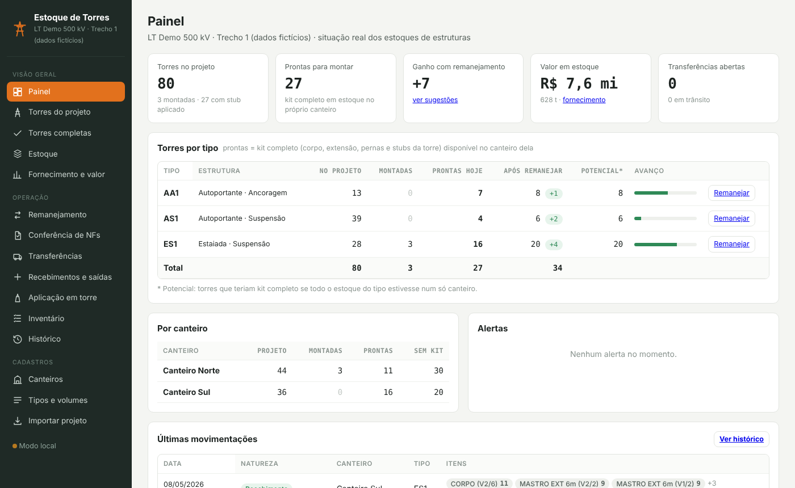
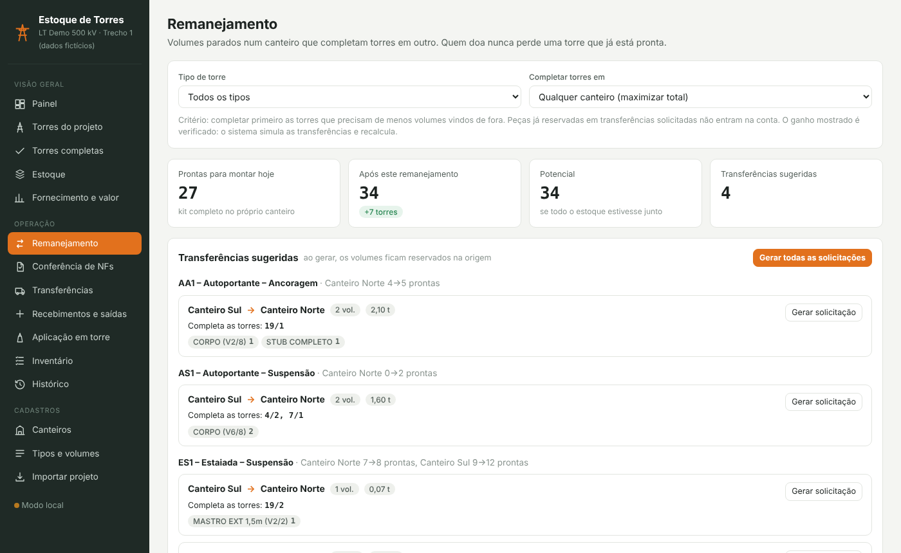
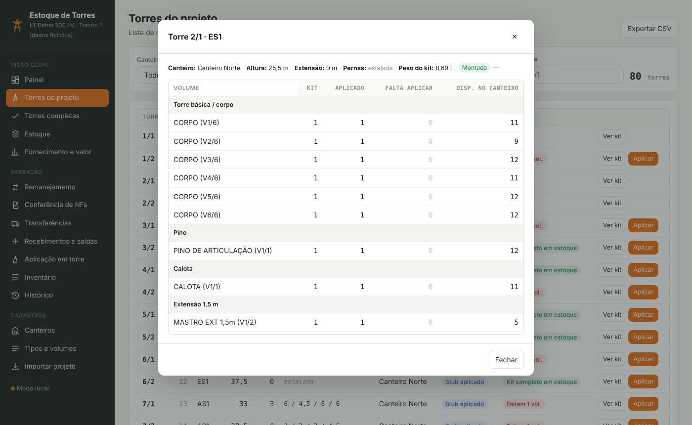
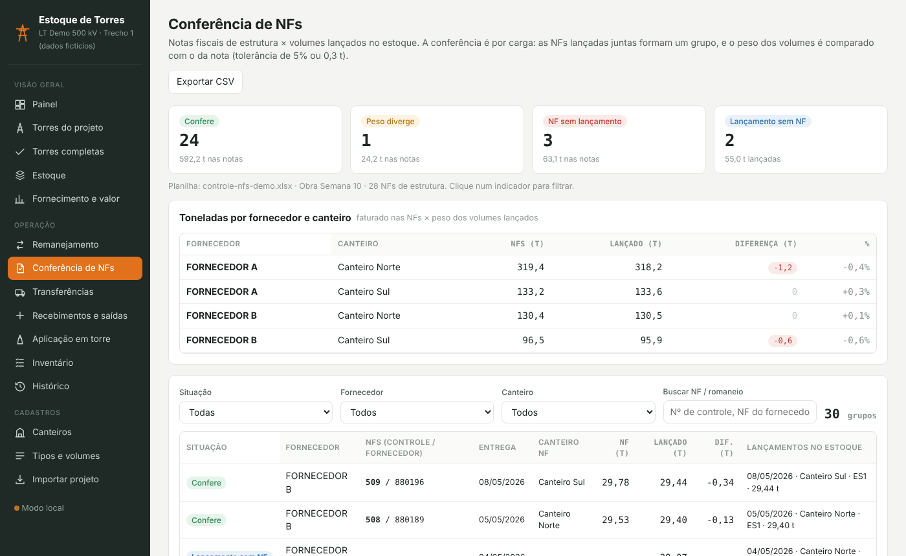
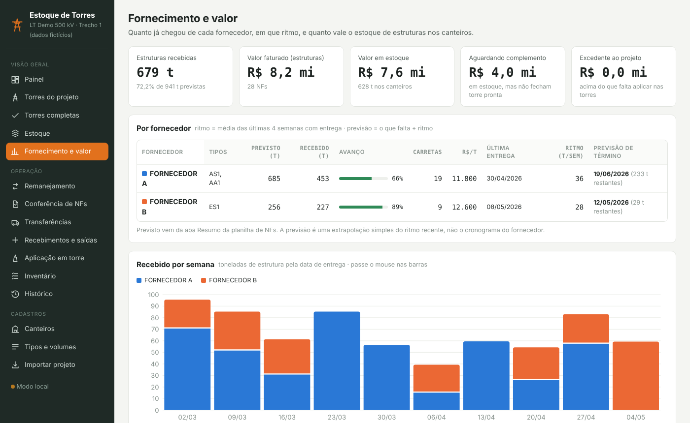

# Estoque de Torres — controle de estruturas de linhas de transmissão

Sistema para controlar o estoque de **estruturas metálicas de torres de linha de transmissão (LT)** espalhadas
em vários canteiros de obra. Ele responde às perguntas do dia a dia do planejamento:

- **O que eu tenho de verdade em cada canteiro?** (físico, reservado, disponível, a caminho, em R$)
- **Quais torres já posso montar?** O kit de cada torre é calculado individualmente a partir da lista de construção.
- **Que peças devo mover entre canteiros para completar mais torres?** Exemplo: o pé parado no canteiro X completa a torre do canteiro Y.
- **As notas fiscais batem com o que foi lançado no estoque?**
- **Em que ritmo os fornecedores estão entregando e quando terminam?**



> **Dados de demonstração.** Todos os dados deste repositório (obra, canteiros, fornecedores, volumes, pesos,
> valores e notas) são **fictícios**, gerados por `ferramentas/demo/gerar_demo.py`. Nenhuma planilha ou dado
> real de obra faz parte do repositório.

---

## Sumário
- [O problema](#o-problema)
- [Funcionalidades](#funcionalidades)
- [Como rodar](#como-rodar)
- [Arquitetura](#arquitetura)
- [Regras de negócio](#regras-de-negócio)
- [Importar dados reais](#importar-dados-reais)
- [Testes](#testes)
- [Estrutura do repositório](#estrutura-do-repositório)
- [Roadmap](#roadmap)

## O problema

Uma torre não é uma peça única: ela chega do fabricante em dezenas de **volumes** (corpo, cabeça, extensões,
pernas, stubs…), muitas vezes em caminhões e canteiros diferentes. E **duas torres do mesmo tipo podem precisar
de volumes diferentes**: cada uma tem a sua extensão e cada um dos quatro pés tem a sua altura de perna, conforme a
lista de construção (LC).

No controle feito só em planilha, é difícil saber quantas torres estão realmente completas, qual peça falta em
cada uma e se alguma peça parada em outro canteiro resolveria o problema.

## Funcionalidades

| Tela | O que faz |
|---|---|
| **Painel** | Torres no projeto, montadas, prontas para montar, ganho possível com remanejamento, valor do estoque e alertas (saldo negativo, transferência parada, divergência). |
| **Torres do projeto** | As torres da LC com situação (aguardando, stub aplicado, montagem parcial, montada) e se o **kit completo** está em estoque. Mostra o detalhe do kit de cada torre. |
| **Torres completas** | Prontas × sem kit por canteiro e tipo, e o ranking dos **volumes que mais travam torres** (base para cobrar o fornecedor). |
| **Estoque** | Por volume: disponível em cada canteiro × necessário para as torres pendentes, com reservado e a caminho. |
| **Remanejamento** | Sugere transferências entre canteiros que completam o máximo de torres e lista as torres beneficiadas. Gera as solicitações com um clique. |
| **Transferências** | Fluxo `SOLICITADA → EM TRÂNSITO → RECEBIDA` (ou `CANCELADA`), com reserva na origem e conferência de divergência no recebimento. |
| **Recebimentos e saídas** | Entrada por NF/romaneio (o sistema confere o peso digitado contra o da nota) e baixas com motivo. |
| **Aplicação em torre** | Baixa por torre: só os stubs (fundação) ou tudo o que falta (montagem). A torre vira "Montada" quando o kit inteiro foi aplicado. |
| **Inventário** | Contagem física e ajuste automático só da diferença, com justificativa. |
| **Conferência de NFs** | Cruza as notas fiscais com os recebimentos por **carga**. Situações: confere, peso diverge, NF sem lançamento, lançamento sem NF. |
| **Fornecimento e valor** | Previsto × recebido por fornecedor, gráfico semanal, ritmo e previsão de término. Valor do estoque em R$, valor parado (não fecha torre) e excedente. |
| **Histórico** | Razão completo com filtros e exportação CSV. Nada é apagado: correções são feitas por estorno. |
| **Importar projeto** | Carrega o pacote do projeto (tipos, volumes, LC, histórico) e lê a **planilha de NFs direto no navegador**, para atualizar toda semana. |

| Remanejamento | Kit de uma torre |
|---|---|
|  |  |

| Conferência de NFs | Fornecimento e valor |
|---|---|
|  |  |

## Como rodar

### Interface web (com os dados de demonstração)

Não precisa instalar nada além de Python (para servir os arquivos):

```bash
cd web
python3 -m http.server 8080
# abra http://localhost:8080 → "Importar projeto" → "Carregar e conferir o pacote" → "Importar agora"
# para testar as NFs: escolha docs/exemplos/controle-nfs-demo.xlsx em "Controle de NFs"
```

Rodando assim, fora de um backend, o app funciona em **modo local**: os dados ficam na memória do navegador e
somem ao recarregar. Na versão publicada como artefato no Claude, ele usa um banco compartilhado entre os
usuários, com controle de permissão (Editores alteram cadastros; Colaboradores lançam movimentações).

> `web/index.html` é gerado por `python3 web/build.py` a partir de `index.src.html`, `styles.css`, `core.js` e `app.js`.

### API (Java / Spring Boot)

```bash
cd api
mvn spring-boot:run                    # H2 em arquivo, sem configuração
# Swagger: http://localhost:8080/swagger-ui.html

docker compose up -d                   # PostgreSQL
mvn spring-boot:run -Dspring-boot.run.profiles=postgres
```

Detalhes em [`api/README.md`](api/README.md).

## Arquitetura

```
┌──────────────────────────── web/ ─────────────────────────────┐
│ app.js   telas, formulários, importação, exportação CSV        │
│ core.js  REGRAS DE NEGÓCIO PURAS (sem DOM) ← testadas em Node  │
│          saldos · kit por torre · alocação · remanejamento     │
│          leitura da planilha de NFs · conferência NF × estoque │
└───────────────┬────────────────────────────────────────────────┘
                │ mesmo modelo de domínio
┌───────────────┴──────────── api/ ──────────────────────────────┐
│ Spring Boot 3 · JPA · Flyway · H2/PostgreSQL · OpenAPI          │
│ dominio/calculo  regras puras (CalculadoraTorres, Planejador)   │
│ servico          transações, travas, validações                 │
│ api              REST + erros RFC 7807                          │
└────────────────────────────────────────────────────────────────┘
```

Decisões principais:

| Decisão | Por quê |
|---|---|
| **Razão append-only**: o saldo é sempre a soma dos movimentos | O saldo nunca diverge do histórico. Correções são feitas por **estorno**, o que mantém a auditoria completa. |
| **Regras em módulo puro** (`core.js` e `dominio/calculo`) | Dá para testar com dados de verdade sem tela nem banco. |
| **Trava por canteiro** antes de retirar peças (lease no web; `SELECT … FOR UPDATE` na API) | Duas pessoas não consomem o mesmo saldo ao mesmo tempo. |
| **IDs determinísticos** em despacho/recebimento/estorno/importação | Repetir a operação não duplica lançamento (idempotência). |
| **Reserva** de peças em transferência solicitada | A peça prometida a outro canteiro não é usada numa montagem nesse meio-tempo. |
| **Leitura de planilha no navegador** (SheetJS), com colunas localizadas pelo cabeçalho | O usuário atualiza as NFs toda semana sozinho, e a leitura aguenta coluna inserida ou movida. |
| **Gráfico em SVG próprio** com paleta categórica validada para daltonismo | Sem dependência pesada; legenda e tabela de apoio garantem a leitura. |

## Regras de negócio

### Kit de cada torre

Cada tipo de torre tem um catálogo de volumes organizados em **grupos**: `TB` (corpo), `EXT{m}` (extensões),
`PERNA{m}` (pernas), `AP/STB` (stubs), `PINO`, `CALOTA`. O kit de uma torre é a soma de um volume de cada grupo
que ela usa:

| Estrutura | Kit |
|---|---|
| **Autoportante** | `TB` + `EXT{extensão da torre}` + **uma `PERNA{h}` por pé** (A, B, C, D, cada um na sua altura) + 4 stubs |
| **Estaiada** | `TB` + `PINO` + `CALOTA` + extensões até a altura nominal: `(altura − altura base)` coberta por módulos de 6 m mais um de 1,5 / 3 / 4,5 m + 4 stubs |

A regra de cada tipo é configurável na tela **Tipos e volumes**.

### Torres prontas para montar

Para cada canteiro, o estoque disponível (físico − reservado) é alocado às torres pendentes **na ordem da lista
de construção**. Uma torre está "pronta" quando o que ainda falta aplicar nela cabe inteiro no que sobrou.

### Remanejamento

1. Calcula as torres prontas de cada canteiro. O que não foi alocado é a **sobra**: só a sobra pode ser doada, então **nenhum canteiro perde uma torre pronta**.
2. Conta como já disponível no destino o que está solicitado ou em trânsito, para não sugerir a mesma peça duas vezes.
3. Guloso: a cada passo completa a torre que precisa de **menos volumes vindos de fora**, tirando dos doadores com mais sobra.
4. **Verificação:** simula as transferências, refaz a alocação e mostra o ganho **confirmado**, não o estimado.
5. Agrupa os movimentos em transferências origem → destino, com a lista das torres que cada uma completa.

### Conferência de NFs × estoque

- A chave é **fornecedor + nº da NF de controle**, porque o mesmo número de NF pode existir em fornecedores diferentes. Se não casar, o sistema tenta a NF do fornecedor e depois o romaneio.
- Um recebimento pode citar várias notas ("NF 142, 143 e 145"). As notas e recebimentos ligados formam uma **carga** (union-find), e o peso dos volumes é comparado com o das notas (tolerância de 5% ou 0,3 t).
- Valor do estoque = toneladas × R$/t médio de cada fornecedor, calculado pelas próprias NFs.

## Importar dados reais

Os dados reais **não** ficam no repositório. Para gerar o pacote de uma obra a partir das planilhas de controle:

```bash
pip install openpyxl
python ferramentas/importacao/importar_planilhas.py \
  --estoque planilha-estoque.xlsx --projeto planilha-projeto.xlsm \
  --obra "Nome da obra" --saida web/dados-projeto.json
```

O layout esperado das abas está descrito no topo do script. O saldo final de cada volume é conciliado com a
coluna de estoque do resumo, e as linhas que não puderam ser importadas aparecem num relatório na tela de
importação. O arquivo `web/dados-projeto.json` está no `.gitignore`.

A planilha de notas fiscais é lida pelo próprio app (tela **Importar projeto → Controle de NFs**). Um exemplo
fictício do layout está em `docs/exemplos/controle-nfs-demo.xlsx`.

## Testes

```bash
# regras da interface web (Node 18+)
cd web && npm install && npm test

# API
cd api && mvn test
```

Os testes da interface verificam, com os dados de demonstração:
- **Kit de cada torre:** toda torre da LC monta um kit válido, com os casos de estaiada e de pernas diferentes.
- **Remanejamento:** nunca piora a situação, nenhum doador perde torre pronta e o ganho anunciado se confirma ao aplicar as transferências.
- **Transferências:** uma transferência solicitada não é sugerida de novo, e a máquina de estados não aceita transições inválidas.
- **Notas fiscais:** a planilha é lida corretamente e cada recebimento cai em exatamente um grupo da conferência.

A API tem testes unitários das regras, incluindo invariantes em cenários aleatórios, e um teste de integração do
fluxo completo com MockMvc.

## Estrutura do repositório

```
web/                    interface (HTML/CSS/JS puro)
  core.js               regras de negócio puras
  app.js                telas
  dados-demo.json       pacote de demonstração (fictício)
  tests/                testes em Node
api/                    API REST Java 21 + Spring Boot 3
ferramentas/
  importacao/           planilhas da obra → dados-projeto.json
  demo/                 gerador dos dados fictícios
docs/
  img/                  capturas de tela (dados fictícios)
  exemplos/             planilha de NFs fictícia
```

## Roadmap

- [ ] Levar o **kit por torre** e a conferência de NFs para a API Java (hoje a API usa composição fixa por tipo)
- [ ] Ligar a interface web à API
- [ ] Autenticação e perfis (almoxarife, planejamento, gestor) com Spring Security
- [ ] Controle de cabos (condutor e OPGW) por bobina
- [ ] Custo de frete entre canteiros no critério do remanejamento
- [ ] Testcontainers com PostgreSQL nos testes de integração

## Autor

**Fernando Henrique** · [LinkedIn](https://www.linkedin.com/in/fernandohenrique-dev)

Projeto pessoal desenvolvido para estudo de desenvolvimento back-end e para resolver um problema real de
planejamento de obras de transmissão. Licença [MIT](LICENSE).
